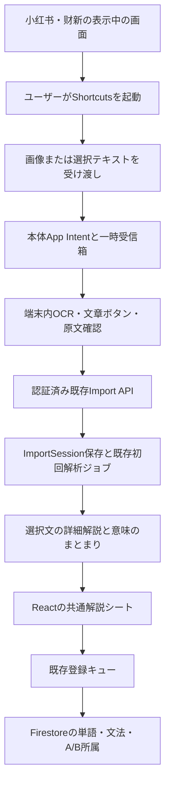

# iPhoneの画面から中国語を読み解き、外部ソースとして登録する機能：詳細計画

作成日: 2026-10-24

状態: **設計のみ・未実装**。チェックリストは今後の実装・検証作業。実機のOS、Shortcutsの撮影結果、小红书・财新の共有内容は今回未検証。

## 1. 目的と実現範囲

小红书の投稿・コメント、财新の記事を読むとき、文章を毎回コピーしてChatGPTへ移す手間を減らす。読みたい文章を選び、「全体の意味 → 意味のまとまり → その中の単語・文法」を確認し、既存の外部ソースと同じ方法でDBへ登録する。

既に実装されている[個人用iPhoneアプリ](../docs/ios-personal-app.md)を拡張する。対象は本人のiPhone、中国語を学習言語、日本語を解説言語の初期値とする。UIは既存どおり英語・日本語・韓国語に対応。AndroidやMacの機能追加は含めない。

### 1.1 希望する体験とiOSでの設計上の差

| 希望 | 採用する方式・制限 |
| --- | --- |
| コントロールセンターのボタンから開始 | 初版はユーザーが登録するShortcutsのコントロールを利用。独自Control Widgetは後段 |
| 開いているアプリの文章にボタンが出る | **取り込んだ静止画をVocab Trainer内に表示し、その画像上に文章ボタンを重ねる** |
| 小红书のコメントも選べる | その時点で画面に見えているコメントをOCR対象にする。未展開・画面外のコメントは取得できない |
| 押すと解説ボックスが開く | Vocab Trainer内のボトムシートで表示する |
| 単語・文法をDBへ追加 | 既存ImportSession・候補・登録キュー・A/B所属処理を利用する |
| 元のアプリを読み続ける | シートを閉じて他の取得済み箇所を選ぶか、OSのアプリ切替で元のアプリへ戻る |

**小红书・财新の操作中の画面に、当アプリの独自ボタンや任意の解説ウィンドウを常駐させる仕様は採用しない。** iOSの公開APIに基づく通常のアプリ構成では、他社アプリのビュー階層を書き換える権限や汎用の任意UIオーバーレイは提供されない、という設計判断による。画面取得の許可と他アプリ上へのUI表示権限は別である。[Appleのアプリ分離の説明](https://support.apple.com/guide/security/security-of-runtime-process-sec15bfe098e/web)

したがって、原案をそのまま実装可能と扱わない。以下は**アプリ内に画面を再現する代替案**の詳細計画であり、原案とのこの差は実装着手時にも説明する。元アプリ上での操作継続が必須なら、M0で仕様判断に戻る。脱獄、非公開API、開発用UI自動操作、PiPを汎用操作画面に見せる回避策は前提にしない。

### 1.2 初版の完了条件

1. 小红书の表示中の投稿・コメントを、文章のコピーなしで取り込める推奨経路を実機で確認する。
2. 画像内の文章・コメントを別々に選べ、OCRの誤認識や結合を直してから解析できる。
3. 意味のまとまり、対応する単語・文法、拼音、日本語解説を同じシートから読める。
4. 単語・文法を個別にA/Bへ登録し、保存された外部ソースから再度開ける。
5. アプリ切替、認証切れ、応答喪失、二重タップでも、意図しない二重登録や異なるコメントの混同を起こさない。
6. 操作回数・待ち時間・OCR品質を実測し、従来のコピー→ChatGPTに対する改善と残る手間を記録する。未計測の速度を保証しない。

## 2. 確認した既存機能と依存関係

確認対象はローカルの `0bc0727` 時点のコード。今回、本番データの内容は調査していない。

| 現在の場所 | 再利用するもの／必要な変更 |
| --- | --- |
| [iOSガイド](../docs/ios-personal-app.md) | Capacitor 8.5.3、React同梱、最低iOS 15、Personal Team、native認証。新しい入口だけOS条件を分ける |
| [SceneDelegate.swift](../frontend/ios/App/App/SceneDelegate.swift)、[NativeAuth.swift](../frontend/ios/App/App/NativeAuth.swift) | native→React受け渡し、cold/warm start、プラグイン登録。既存認証コールバックを維持 |
| [ImportView.tsx](../frontend/src/components/ImportView.tsx) | 入力→セッション作成→初回解析ジョブ→レビュー。画面取り込みも同じ処理へ接続 |
| [useImportSession.ts](../frontend/src/hooks/useImportSession.ts) | 保存、contentRevision競合、候補ID、登録結果、登録先。取得画面と通常レビューで共有 |
| [ImportFullTextReader.tsx](../frontend/src/components/import/ImportFullTextReader.tsx) | 文・単語・構文の選択と詳細解説。シート向けに表示部分を共通化 |
| [ImportComprehension.tsx](../frontend/src/components/import/ImportComprehension.tsx) | 文全体の意味、骨格、文脈、ニュアンス |
| [import.ts](../frontend/src/api/import.ts) | 既存APIクライアント、native Bearerを扱う共通transport、SSE/polling |
| [routes/import.ts](../backend/src/routes/import.ts) | 初回セッション作成、保存、一文解説。作成は現状201、解析ジョブ開始は別操作 |
| [firestore.ts](../backend/src/firestore.ts) | ImportSessionの作成は現在自動ID。取得はdocument内容のspread。今回の作成再試行を扱う処理が必要 |
| [import-jobs.ts](../backend/src/import-jobs.ts)、[import-job-store.ts](../backend/src/import-job-store.ts) | 永続ジョブ、原文単位のcheckpoint、既存Cloud Tasks/worker。画像用の別解析キューは作らない |
| [意味のまとまり計画](source-meaning-units-design.md) | **未実装**。meaningUnitsのschema・原文一致・保存・表示を本機能の前提として実装 |
| [修正仕様](../docs/source-revisions.md) | 解説のみの修正、候補変換、履歴、undo、候補保護 |

上限は現行の入力8,000 UTF-16コード単位、セッション900,000 UTF-8バイト、一文詳細150,000バイトを継承する。画像はこのFirestore文書に入れない。

初回解析は単語・文法候補をcompact形式で抽出し、選択文の詳細を後から生成する。**ユーザーに見せる順序を意味→単語・文法とするが、LLMの処理順序を意味解析先行には変更しない。** 初回処理の約600文字バッチも意味のまとまりではない。

## 3. 取得方法の選定

### 3.1 初版：Shortcutsから画像またはテキストを渡す

推奨ショートカット「この画面を中国語学習」:

1. コントロールセンターからユーザーが起動する。
2. コントロールセンターを閉じ、対象画面が再表示されてからShortcutsのスクリーンショット取得アクションを実行する。
3. その画像を、Vocab Trainer本体に実装する画像入力App Intentへ渡す。
4. **撮影後に**Vocab Trainerを前面へ出し、受信画像の確認・OCR画面を開く。

コントロールセンターから任意のショートカットを実行できることはAppleの説明で確認した。上の撮影順序、閉じるアクションの提供状況、OSごとの表示タイミングまで保証する資料ではないため、固定秒数の待機だけで成功とせずM0の実機検証で確定する。[Apple Shortcutsガイド](https://support.apple.com/guide/shortcuts/run-shortcuts-from-control-center-apd06a9201d4/ios)

画像受信は `IntentFile` を使う案とし、main app target内のApp Intentで受け、アプリの前面実行モードを選ぶ。新旧OSで使用できる起動指定が異なるため、deployment targetとSDK availabilityに合わせて実装する。新しいAPIをiOS 18で使えるものとして無条件に参照しない。[Intentのパラメータ](https://developer.apple.com/documentation/appintents/adding-parameters-to-an-app-intent)、[実行モード](https://developer.apple.com/documentation/appintents/configuring-the-runtime-behavior-of-your-app-intents)

初版はWidget Extension、Share Extension、App Groups、共有Keychainを必須にしない。アプリ本体で受信・OCR・認証付き通信を実行する。無料署名で実際に画像受信から前面表示まで動くことをM0で確認する。

### 3.2 必ず用意する代替入口

| 状況 | 入口と動作 |
| --- | --- |
| コントロールセンター経由で撮影するとコントロール自身が写る | 物理ボタンで撮影→スクリーンショットの共有→同じ画像受信ショートカット |
| 小红书が共有できるのはURLだけ | スクリーンショットを使う。URLからコメントを取得できるとは扱わない |
| 财新で文字を選択・共有できる | 選択テキスト→共有シートに表示したShortcuts→テキスト受信Intent。OCRを省略 |
| テキスト共有ができず「复制」だけがある | 明示的にコピー→アプリの貼り付けボタン。起動時の自動クリップボード読み取りはしない |
| 古いOS／App Intentや共有経路を利用できない | アプリ内のシステム写真選択UIからユーザーが画像を選ぶ、または既存外部ソース入力へ貼り付ける |

共有シートに登録するのは初版では**ショートカット**であり、独自Share Extensionではない。画像を任意の外部URLへ送るショートカットは配布しない。初回設定手順と渡すデータを利用者に見える形で説明する。

URLしか渡されなかった場合は、本文が取得済みであるように表示しない。初版はログイン済み記事のサーバー取得や有料記事の全文取得を行わず、渡されたテキスト・画像だけを使う。

### 3.3 OSと署名の扱い

- 既存アプリ全体の最低iOS 15は維持する。App Intents経路は対応OSでのみ有効にし、コントロールセンターの推奨導線はiOS 18以降を検証対象とする。
- 実際の利用端末のiOS/Xcode/署名条件をM0で記録する。無料署名の期限更新手順は既存ガイドを継承する。
- 独自Control Widgetは将来、取り込み画面やショートカット設定案内を開く入口として追加できる。ただしControl Widget自体に他アプリの撮影機能が付くわけではない。[Apple Controls](https://developer.apple.com/documentation/widgetkit/creating-controls-to-perform-actions-across-the-system)
- ExtensionやApp Groupsを後から追加する場合、利用可能capabilityと署名条件を別途確認する。現在の「有料会員不要」がそのまま適用されるとは約束しない。[Apple capability一覧](https://developer.apple.com/help/account/reference/supported-capabilities-ios)

### 3.4 画面共有APIの調査結果と後段候補

確認時点のApple資料には、ScreenCaptureKitによるiOS画面取得のサンプルがあり、**iOS 27以降・Beta表記**を含む。将来の取得経路として再評価するが、本人の端末対応・正式SDK・署名・OSの許可画面を検証していないため初版の必須依存にはしない。資料を根拠に「iPhoneには画面共有APIが一切ない」とは判断しない。[AppleのiOS画面取得サンプル](https://developer.apple.com/documentation/screencapturekit/capturing-screen-content-on-ios)

旧OS向けReplayKit Broadcast Upload Extensionも比較対象になるが、録画開始の操作、拡張プロセスとの受け渡し、メモリー・電池・録画停止管理が増える。スクリーンショットで要件を満たせない場合にだけ再検討する。どちらの方式でも「他アプリに任意の解説ボタンを重ねる」問題は解消しない。[ReplayKitのシステム選択UI](https://developer.apple.com/documentation/replaykit/rpsystembroadcastpickerview)

## 4. 利用体験と画面仕様

### 4.1 小红书の投稿・コメント

1. 小红书で読みたい投稿・コメントを表示する。折り畳みコメントは先にユーザーが展開する。
2. 「この画面を中国語学習」を起動する。Vocab Trainerへ切り替わり、「取り込んだ画面・取得時刻」を表示する。
3. OCRした文章候補に番号付きの「解説」ボタンを置く。投稿本文と各コメントは別候補。名前、時刻、返信・いいね等のUIラベルは選択候補からなるべく除外する。
4. 読みたい候補をタップするとシートが開く。原文を確認し、必要なら誤字、改行、範囲を修正して「解析する」を押す。
5. 保存済み部分と進捗を表示し、解析完了後に文全体→意味のまとまり→単語・文法を表示する。
6. 学びたい候補だけを登録する。シートを閉じれば同じ画像の別コメントを選べる。

MVPは**一度に一つの投稿ブロック／一つのコメントを一つのImportSessionにする**。複数文を含むコメントは一記事内の複数文になる。別ユーザーの隣接コメントを一つの記事に自動連結しない。この方針で既存の「前後一文」を無関係なコメントとしてLLMへ渡す事故を避ける。

「确实」「这也太离谱了吧」等、単独では意味が定まらないコメントには文脈不足を表示できるようにする。投稿本文や親コメントを勝手に取得・推測しない。初版では別途取り込んで読むか、既存の修正指示で背景を明示する。親子コメントを構造化した文脈入力は後段とする。

### 4.2 财新の記事

文字共有できる場合はテキスト経路を優先し、OCRによる誤字を避ける。画面内の段落を複数選びたい場合は、同じ記事の続きであることをユーザーが確認して連結する。段落の順序と区切りは編集できるようにする。

8,000文字を超える場合は自動切断せず、段落単位の分割を提案する。次画面の取り込みは初版では別ソースとし、長い記事の自動スクロール、連続撮影、画面間の重複除去は後段に分ける。

### 4.3 シートの表示

```text
取得した画面（静止画）                   閉じる
    投稿本文                      [① 解説]
    コメントA                     [② 解説]
    コメントB                     [③ 解説]

┌ 選んだ文章 ──────────────────────────┐
│ 原文／OCRを修正／別の範囲を選ぶ           │
│ [解析する]  選択した文章をサーバーへ送信    │
│ この文が言いたいこと                    │
│ ① 意味のまとまり：原文・意味・役割        │
│   [この部分の単語] [関連する文法]         │
│ ② 意味のまとまり：原文・意味・役割        │
│ まとまり同士のつながり                   │
│ 選択語：拼音・この文での意味・解説         │
│ [Aへ追加] [Bへ追加]  登録先／保存状況      │
│ [外部ソースで詳しく見る]                 │
└─────────────────────────────────────┘
```

- 原文確認は送信前に行う。「解析する」は外部ソースとして本文を保存し、既存LLMへ送る操作。辞書の単語・文法登録とは区別する。
- 一文の中のまとまりは既存計画の定義に従う。複数文の文章は文選択を上位に置き、選択文のまとまりを表示する。
- 短文は一つのまとまりを許す。長い説明を常に全展開せず、選択語・構文を切り替える。
- ボタンの最小タップ領域は44pt相当。近接するコメントでは番号と下部リストを併用し、本文を隠す密集ボタンを避ける。
- 画像をズームしてもボタンを追従させる。VoiceOverでは同じ候補を読み順のリストで選択可能にする。
- 360px幅、Dynamic Type、キーボード表示、ダークモード、safe areaを確認する。
- 「元のアプリに戻る」はOS操作を案内する。任意のアプリ名・URL・復帰先を自動取得できる前提にしない。ユーザーが渡したHTTPS記事URLがあれば明示操作で開ける。

## 5. OCR、ブロック検出と位置情報

### 5.1 native OCR

Apple Visionの `VNRecognizeTextRequest` をaccurate設定で使い、対応するrecognition languageを実行環境で確認して簡体字・繁体字・英語を指定する。Visionの処理は端末内で行える。中国語は認識結果が一語単位ではなく行や断片になる場合があるため、OCRの矩形をそのまま「単語」や「意味単位」と見なさない。[Apple Vision文字認識](https://developer.apple.com/documentation/vision/recognizing-text-in-images)

処理順:

1. MIME/UTType、実際のデコード結果、ファイルサイズ、展開後ピクセル数を検証する。
2. EXIF方向を適用して画像を正立させ、**その画像**を表示とOCRの共通基準にする。
3. 行文字列、候補、confidence、矩形を取得する。OCRはバックグラウンドqueueで実行し、キャンセルと世代番号を持つ。
4. 行高・左右位置・行間・空行・段落幅から近接行をグループ化する。別コメントの結合を避ける保守的な閾値にする。
5. 認識行のテキストと幾何位置を保持したまま、UI用候補を作る。
6. ユーザーが分割・結合・範囲選択・原文修正を行い、解析対象を確定する。

本文／コメント／画面UIの識別は画像からの推定で、元アプリのDOMやアクセシビリティツリーを取得するものではない。confidenceは文章の意味の正しさを示す値でもない。低confidenceには修正案内を出すが、高confidenceでも編集できる。

仮の入力予算は**一画像20MiB以下、展開後20メガピクセル以下、一回一画像**。超過時は縮小または切り抜きを提案し、無断で読めない解像度へ落とさない。実機M0/M2でメモリー量と小さいコメントの精度を測り、閾値を確定する。

### 5.2 座標契約

- nativeから渡す矩形は、正立画像全体に対する左上原点・0〜1の正規化座標に統一する。
- Visionの左下原点から `top = 1 - y - height` へ変換する。すべて有限値、幅高さは正、画像内に収まることを検証する。
- Web側はobject-fitの余白、表示スケール、ズーム、パンを同じ変換行列に含め、ボタン位置を計算する。
- OCRの改行を結合した結果と元の行矩形の対応表を保持する。原文修正後は文字単位の位置対応が失われるため、旧座標で単語を指したふりをしない。
- 初版の画像上の操作は**文章ブロック**だけ。意味単位や単語のハイライトはシート内の確定テキスト上で行う。これによりOCR訂正後の画像座標を無理に再構成しない。
- 同一文が二つのコメントにあっても、画像ID＋ブロックIDで別の出現として扱う。

### 5.3 OCRの補正方針

絵文字、ハッシュタグ、＠、中国語スラング、繁簡混在、数字・固有名詞を黙って正規化しない。「己／已」「未／末」等の誤読をユーザーが訂正できる。モデルによる補完をOCR結果として採用しない。

解析前の確定テキストを原文とする。解析開始後にOCRを直すと原文範囲と既存候補が変わるため、初版は**訂正版を新しいソースとして作成**し、旧ソースと登録済み辞書項目を保持する。既存の解説修正機能は原文そのものの訂正には流用しない。

## 6. アーキテクチャとデータの流れ



### 6.1 native受信とReactの引き渡し

新規プラグイン案 `NativeCapture`:

- `listPendingCaptures()`：未処理の入力メタデータを読む。
- `loadCapture(captureId)`：本体sandbox内の検証済み入力を読む。任意のファイルパスは受け付けない。
- `recognizeCapture(captureId)`：OCRを開始し、行・候補・正規化矩形を返す。
- `acknowledgeCapture(captureId)`：取り込み画面の受領を記録する。DB保存成功と混同しない。
- `discardCapture(captureId)`：入力と生成したローカル一時データを消す。
- `captureReceived` event：warm start向けの通知。通知喪失に備え、cold start・復帰時に必ず一覧を読む。

型付きメタデータをbridgeで渡し、画像はアプリ管理下のローカルresource URLで表示する。Base64を繰り返しJSONへ載せたり、任意URLやファイルパスをWeb側から読み出せるプラグインにしたりしない。

初回Intentでファイルを本体sandboxへ原子的にコピーしてから受領完了にする。Reactの準備前に通知が届いても消失させない。取得IDとブロックIDごとに送信operationを保持し、二重イベントを同じ取り込みに結び付ける。

既存クイズの未同期回答がある場合は、その警告とキューを保持する。native復帰時の認証確認・answerOutbox同期を迂回せず、入力を受信箱に残してから取り込み画面へ遷移する。受信イベントでページ全体を強制リロードしない。

### 6.2 一時受信箱の保存範囲

初版では、画像・未確定OCR・未送信テキストを**端末の一時受信箱**に限って保持する。学習履歴をローカル永続化する設計ではないが、現行の「学習データは端末に保存しない」説明に対する入力受け渡し上の例外なので、実装時に明記する。

- File Protectionを使用しバックアップ対象外とする。ロック中は内容を表示・解析せず、解除後に再開する。
- 最大10件・合計100MiB・最長24時間という仮予算を設ける。上限時は未送信入力を無断で追い出さず、新規受信を拒否して整理を案内する。
- 送信済み文章の画像も、同じ画面の別コメントを選べるよう閲覧中は保持する。明示破棄・期限切れで削除する。
- iOSが任意時刻に清掃処理を動かす保証はない。24時間後は読み出しを拒否し、次回起動・受信・復帰時に実体を削除する。厳密な24時間以内の物理削除は保証しない。
- ログアウト時は未送信入力があることを示して破棄を確認する。通常の再認証では入力を維持する。
- Cloudへ保存済みの本文・解析・登録結果はFirestoreを正とする。画像はCloudにも写真ライブラリにも自動保存しない。

### 6.3 取得データと保存データを分ける

以下は提案型であり、現行コードに存在しない。

```ts
// native内の一時データ。Firestoreには送らない。
interface LocalCapture {
  version: 1;
  captureId: string;
  receivedAt: string;
  inputKind: 'image' | 'text';
  imageSize?: { width: number; height: number };
  blocks: {
    blockId: string;
    text: string;
    rects: { left: number; top: number; width: number; height: number }[];
    confidence?: number;
  }[];
}

// ImportSessionに追加する任意フィールド。
interface ImportSourceOrigin {
  version: 1;
  method: 'screenshot-shortcut' | 'shared-image' | 'image-picker' | 'shared-text' | 'paste';
  sourceLabel?: string; // 本人が選択・編集した「小红书」「财新」等
  sourceUrl?: string;   // 本人が渡したHTTPSリンク。自動fetchしない
  capturedAt?: string;  // クライアント申告。監査時刻はserver createdAtを使用
  sourceKind: 'post' | 'comment' | 'article' | 'unknown';
  textConfirmed: true;
}
// ImportSession.sourceOrigin?: ImportSourceOrigin
```

`captureId`、画像、矩形、全OCR文字列、未選択コメント、名前・アバターはサーバーへ送らない。選択した確定本文だけを `ImportSession.text` に保存する。originもユーザーの入力として検証し、他アプリのbundle IDを自動識別した事実として扱わない。

originは取得時の固定メタデータとして作成APIで受理し、通常PUTでの書き換えは初版では許可しない。old clientのPUTがフィールドを送らなくてもサーバーmergeで保持する。一覧へ出すラベルは明示的summary mappingに追加する。バックアップ・削除・容量計算にも含める。

`sourceLabel`は100文字、URLは2,048文字を初期上限とし、HTTPS、制御文字、型、日付形式を検証する。URLをログに残さず、アプリ内で表示する文字列をHTMLとして解釈しない。

### 6.4 セッション作成時の再試行

既存のジョブ開始はidempotencyKeyを持つが、**最初のセッション作成は自動IDであり、作成応答を失った時の重複防止には不十分**。今回の新しい入口には次を追加する。

1. 解析操作の最初にUUIDの `ingestionId` を一度作り、確定本文・登録先と共に一時受信箱へ記録する。タイムアウト時に新しいIDを発行しない。
2. 既存 `POST /api/import/:language/sessions` に任意の `ingestionId` と `sourceOrigin` を追加する。既存クライアントは従来の作成経路を維持する。
3. 新規の小さな `import_ingestion_receipts/{hash(language, ingestionId)}` にsessionId、初回要求digest、作成時刻、expiresAtを記録する。本文や画像を重複保存しない。
4. receiptとImportSessionを同じFirestore transactionで作成する。同じID・同じ要求は同じセッションを返し、異なる本文・登録先等なら409。digestは初回要求の正規化した内容から計算し、後から編集されたセッション本文とは比較しない。
5. 初回201、再送200。同時送信も一つのsessionIdとなる。receiptはあるが記事が削除済みなら410で、再作成しない。
6. その後の解析開始・復旧は既存 `analysis-job` APIへ接続する。作成成功後にアプリが終了しても外部ソース一覧から再開できる。

receipt保持は7日を初期方針とする。クライアントは24時間を超えた未確定操作を自動再送せず、保存済みソースの確認を案内する。TTL削除後まで永続的な重複防止を保証しない。TTL設定または既存reconcileでの期限清掃のどちらを使うかM3で確定し、設定がなくても学習データを消さない。receiptの必要性は、通信切断時のソース重複を避けるためであり、新しい解析ジョブ基盤は追加しない。

同じ文章の別の意図的取り込みは別IDにする。文章hashだけで別コメントや別日の学習を勝手に統合しない。再送で解説言語など処理条件が変わる場合も、同一要求として扱う範囲をschema・digestのテストで固定する。

## 7. 意味のまとまりと単語・文法をつなぐ

### 7.1 先に既存の意味単位計画を実装する

[source-meaning-units-design.md](source-meaning-units-design.md)の型、連結一致、UTF-16範囲、書記素境界、容量上限、通常解説と修正ジョブの共通schema、候補保護、旧記事互換を採用する。`ImportReadingAnalysis.version` は1を維持し、任意の `comprehension.meaningUnits` を追加する。

OCR由来であっても、確定本文の一文をunitsのtextで連結すると一字も変えず復元できなければ結果を受理しない。LLMに文字位置を数えさせずサーバーが計算する。登録結果・候補IDを意味単位の生成で変更しない。

### 7.2 今回追加する表示上の対応付け

既存意味単位計画は「各単位から単語・文法を選ぶ」操作を対象外にしている。**本計画ではそのUIを追加**する。意味単位に候補IDを永続保存する方式には変えない。

表示時の純粋関数 `projectMeaningUnitDetails` を設ける:

1. 一文のsourceText一致とrangeを確認する。
2. unit範囲と `ImportOccurrence.range` の交差から、その単位に属する単語の出現を求める。
3. unit範囲と `ImportConstruction.ranges` の交差から関連構文を求める。非連続構文や「虽然…但是…」のような複数単位にまたがる構文は、全体を保持して「複数のまとまりに関係」と表示する。
4. occurrenceから登録候補への紐付けは既存の出現・候補リンクを使う。同じ文字列の最初の候補へtermだけで結び付けない。
5. 一つの候補が複数unitに出ても登録状態の実体は一つ。unitごとに別候補を作らない。
6. unit境界が語の途中に来る場合は語を分断せず、語全体と跨る範囲を表示する。意味単位の構造検証と語候補の修正を混同しない。
7. 対応候補のない固定文法要素は既存構文の詳細を開く。「単語として扱う」が必要なら既存変換フローへ移る。

意味単位とoccurrence/constructionは同じsourceTextと解説世代から読む。別世代の位置を混ぜない。意味単位なしの旧解説は従来表示と明示生成ボタンへフォールバックする。

### 7.3 解説生成の寿命

初回compact解析は既存永続ジョブのまま。詳細解説は既存の一文APIを使い、結果をフロントで取り込みautosaveする。これはバックグラウンド継続・サーバー保存を保証する経路ではない。

- 文を初めて開いた時の既存自動生成条件を守る。保存済み解説があれば再利用し、タップごとの再課金を避ける。
- 同じ文の同時生成をまとめ、画面移動後の遅延結果は記事ID・文index・原文・編集世代で拒否する。
- アプリがbackgroundになった時点では、成功表示を先走らず保存状態を表示する。切断時は保存済み内容を保持して再試行を案内する。
- 解説を閉じた後も生成継続が必要な将来版では、既存の「解説のみ」修正ジョブ経路を検討する。初版では暗黙の自動採用を追加しない。

## 8. DB登録と不変条件

新しいnative APIからFirestoreを直接書かない。Reactの既存 `registerItem`、word/grammar queue、`check-terms`、membership再取得を再利用する。

| ケース | 動作 |
| --- | --- |
| 未登録単語 | 確定原文の文と文脈上の意味を既存smart-addへ渡す |
| 登録済み単語 | 既存IDを再利用し所属を追加。辞書の定義を自動変更しない |
| 同じ語が別コメントにも出現 | 出現と意味は各ソースに保持。ライブラリのID・重複回復は既存契約に従う |
| 文法 | 同じ候補／既存IDの再利用経路を使う。単語と異なる重複判定をterm一致だけで置換しない |
| B未選択 | Bボタンを無効にし登録先を案内する。画面を読んだだけでBグループを作らない |
| AとBを連続タップ | 既存のdestinationごとの状態・per-term create lockを使う |
| 作成成功後に所属追加が失敗 | 実entity IDと未完了の登録先を保持し、所属だけ再試行する |
| 登録応答が失われる | 既存409/不確実な応答の回復とDB照合を使う。登録済みと推測して成功表示しない |

Group AはBを含むライブラリ、Bは閲覧素材との文脈上の所属という意味を維持する。Aの単語所属は最大一つ、文法は複数可、Bは重複可。A移動ではadd-before-removeを維持する。B登録は既存mixed quizのlive scopeへ反映されるが、完了済みクイズを再開させない。廃止済みGroup B単独quizを復活させない。

ソース削除・画像破棄・意味解説のundoで単語・文法本体や既存学習履歴を逆更新しない。保存済みソースを開き直した時には従来どおり実DBとの登録状態を再照合する。

## 9. 状態とエラー設計

基本状態は `received → recognizing → selecting → confirming → savingSource → analyzing → reading → registering`。`reading`と登録は独立で、登録中も確定解説を読める。入力単位と文単位のbusyを分ける。

| 条件 | 表示・回復 |
| --- | --- |
| 画像取得キャンセル／権限拒否 | 未取得を表示。文章入力・画像選択の代替入口を残す |
| コントロールセンター／違う画面が写った | サムネイル確認で破棄・再取得。自動解析しない |
| 黒画面・保護された内容 | 取得失敗を表示。保護を回避する手段を実装しない |
| OCR文字なし／小さい文字 | 拡大表示・切り抜き・別画像・コピー入力を案内 |
| 複数コメントを誤結合 | 原文確認で分割・範囲再選択し、送信前に直す |
| オフライン | ローカルOCR・修正まで可能。送信は保留、LLM解析・DB保存済みとは表示しない |
| 認証期限切れ／401 | 選択とoperation IDを保持して既存nativeログインへ。再認証後に同じ要求を再送 |
| 201/200の応答喪失 | 同じingestionIdで同じsessionIdを回収 |
| 解析202応答喪失 | 同じsessionIdのjob状態を取得し、別ジョブ・別記事を作らない |
| 429/5xx／モデル失敗 | 既存有限再試行・進捗・明示再試行を使用。LLMの二重課金を完全防止したとは説明しない |
| 一文解説だけ失敗 | compact結果と原文を表示し、その文だけ再試行 |
| 409競合 | 保存済み内容との比較へ。未保存編集を破棄せず、強制上書きしない |
| 容量超過 | 保存済み部分を維持し、対象文・文章の分割を案内 |
| 画像期限切れ | 保存済みソースはテキストで開く。元画像の復元は約束しない |
| 本体の無料署名期限切れ | Xcodeでの再署名手順を案内。DBは残るがIntent起動可能とは扱わない |

## 10. 認証・情報の扱い・コスト

- native tokenは既存Keychainとtransportを使用する。Shortcuts、URL、画像メタデータ、共有設定にBearerやAPIキーを置かない。
- 既存は許可メールによる共有データセットでありユーザー別テナントではない。「自分しか見えない専用領域」を新機能の説明として追加しない。
- OCRは端末内、外部送信は確認済み本文と最小originに限定する。画面全体のクラウドOCRは初版では使わない。
- 内容に含まれる命令は学習対象の文章として扱う。LLM出力はschema・原文一致で検証し、入力文章によるツール実行や自動DB登録をさせない。
- 画像・本文・OCR全文・URL・認証情報を通常ログやメトリクスへ出さない。計測対象は時間、件数、文字数、エラー分類、OS版などに絞る。
- 解析は選択ブロックだけ。画面内の全コメントを先読み生成しない。OCRの段階ではLLMを呼ばない。
- 意味単位は既存詳細解説の出力拡張で取得し、意味単位専用の追加LLM呼び出しを作らない。出力量増加による時間・費用は測定する。

## 11. 変更対象と実装単位

「新規」は実装時に作成する予定の名前。既存意味単位計画の変更一覧は重複実装せず、一つの共通基盤にまとめる。

| 対象 | 作業 |
| --- | --- |
| frontend/ios/App/App/CaptureIntents.swift（新規） | 画像・テキスト受信App Intent、前面表示、入力検証 |
| frontend/ios/App/App/CaptureInbox.swift（新規） | 原子的な一時受信、保護、期限、削除、operation対応 |
| frontend/ios/App/App/NativeCapture.swift（新規） | bridge登録、OCR、ローカル画像アクセス、イベント |
| frontend/ios/App/App/NativeAuth.swift / SceneDelegate.swift | 共通bridgeのプラグイン登録・復帰連携。認証処理は維持 |
| frontend/ios/App/App.xcodeproj/project.pbxproj、Info.plist等 | 新規ソース、必要な用途説明、OS availability。不要なcapabilityは追加しない |
| frontend/src/platform/capture.ts（新規） | 型付きnative adapter、Webでは非対応として扱う |
| frontend/src/hooks/useCaptureInbox.ts（新規） | React準備後の受信・復帰・重複イベント排除 |
| frontend/src/components/capture/*（新規） | 画像＋ボタン、OCR修正、ブロック一覧、解説シート、設定案内 |
| frontend/src/components/Dashboard.tsx / ImportView.tsx | 取り込み入口、既存セッションとの接続、通常外部ソースへの遷移 |
| frontend/src/components/import/ImportFullTextReader.tsx等 | 共通文詳細表示を抽出。別の解説・登録実装を作らない |
| frontend/src/utils/captureGeometry.ts（新規） | 座標変換・ヒットテスト |
| frontend/src/utils/importMeaningUnitDetails.ts（新規） | unit→出現・構文の表示時projection |
| frontend/src/hooks/useImportSession.ts / api/import.ts | origin、ingestionId、同一要求の回復、未保存警告 |
| backend/src/routes/import.ts / firestore.ts | 作成transaction、receipt、schema、保持・削除・summary |
| backend/src/import-ingestions.ts（新規） | 要求digest・receipt検証・期限契約 |
| backend/src/types.ts / frontend/src/types.ts | origin、意味単位、要求・応答の互換型 |
| frontend/src/i18n/translations.ts | 英語・日本語・韓国語ラベルとエラー文 |
| docs/ios-personal-app.md / docs/ios-verification.md | ショートカット設定、対応OS、署名、実機検証、入力の一時保持 |
| README.md / docs/development-reference.md / docs/source-revisions.md | 実装後の挙動と制限。dated auditは書き換えない |

学習言語のAPI pathは `chinese`、OCR言語は `zh-Hans`等、解説言語は `ja`等のISOコードを用いる。同じ変数・enumとして流用しない。

## 12. 段階別計画と判断条件

### M0：端末・取得・署名の実現性検証（最優先）

- [ ] 本人のiOS、利用端末、Xcode、Personal Teamでの現在の起動状況を確認する。
- [ ] main app App Intentへの画像・テキスト入力を最小構成で動かす。
- [ ] コントロールセンターを閉じて撮影し、対象画面が取得されるか、小红书本文・コメント・财新で各10回試す。
- [ ] cold start、warm start、ログイン前、ロック解除後、画面回転、キャンセルを検証する。
- [ ] スクリーンショット共有→Shortcutsと、财新の選択テキスト共有の実際の入力型を確認する。
- [ ] 無料署名のまま動くこと、共有capabilityを暗黙に必要としないことを確認する。
- [ ] 原案との差、操作回数、取得成功率、検証OSを記録する。

**判定:** 撮影前に当アプリが開く、コントロールが写る、受信画像が消える等を解決できない場合、推奨入口として合格にしない。手動スクリーンショット経路は提供できるが、これだけで「コントロールセンターから取り込み完了」とは報告しない。アプリ内画像方式が目的に合わない場合も、この段階で取得方式・仕様を再判断する。

### M1：意味単位の共通基盤

- [ ] 既存意味単位計画の型・正規化・通常生成・修正・保存・互換を実装する。
- [ ] sourceTextと全文連結一致、候補保護、旧ジョブの凍結schemaを検証する。
- [ ] 一般の外部ソースでも動く共通表示を完成させる。

**完了条件:** 画像入力なしでも文全体→意味単位を表示でき、候補・登録記録が変わらない。

### M2：一時受信箱・OCR・選択UI

- [ ] native pluginと一時受信箱、期限・上限・削除を実装する。
- [ ] 正立画像とOCR矩形の統一、読み順、ブロック分割を実装する。
- [ ] 同一画像で複数コメントを個別に選べる画像画面と原文訂正UIを作る。
- [ ] 低精度、文字なし、巨大画像、重複受信、未同期回答を検証する。

**完了条件:** サーバー通信なしで取得→OCR→文章確定ができ、選んでいない文章を送信しない。

### M3：外部ソースへの接続と再試行

- [ ] originの型・作成schema・summaryを追加する。
- [ ] receiptとセッションの作成transaction、同一要求200、相違409、削除後410を実装する。
- [ ] 既存解析ジョブへ渡し、受理応答喪失・画面終了・復帰を検証する。
- [ ] receiptの清掃方針を確定し、データ保持・運用文書へ反映する。

**完了条件:** 切断・二重タップ後も一つのソースへ戻り、通常の外部ソース一覧から再開できる。

### M4：解説シートとA/B登録

- [ ] unitから単語・構文へのprojectionと共通詳細コンポーネントを接続する。
- [ ] UI上の順序、跨る構文、同形語の別出現、文法→単語変換を検証する。
- [ ] 既存登録先・キュー・登録状態を共用し、辞書への直接書き込みを作らない。
- [ ] en/ja/koの翻訳、VoiceOver、Dynamic Type、safe areaを完成させる。

**完了条件:** 一つのコメントから解説を読み、選択候補を登録し、再読込後に実DBの所属を確認できる。

### M5：回帰・実機・品質確認

- [ ] 下記の自動試験とエミュレーター試験を実行する。
- [ ] 実機で小红书・财新の代表画面を各10画面以上確認する。投稿・独立コメント・返信・短文・長文・低コントラストを含める。
- [ ] 実LLMは少数の確認済み本文を使い、構造の正しさと説明の質を別に評価する。
- [ ] 従来手順との操作回数、OCR完了時間、最初の解説までの時間、登録時間、誤結合件数を記録する。
- [ ] 個人の画面画像をfixture・Git・ログへ残さず、合成画面で自動回帰を固定する。

**完了条件:** 取り込み成功だけでなく、説明の使いやすさと登録の整合が確認でき、未検証範囲を明記している。

### M6：文書・配備・端末更新

- [ ] 利用ガイドへShortcuts作成手順、権限、代替入口、元アプリへの戻り方を追加する。
- [ ] 意図した変更をcommitし、masterなら `git push origin master`。別branchでは指示を確認する。
- [ ] backend/Webは `./deploy.sh`。runtime schemaで完結する意味単位実装なら設定アップロード不要。設定変更を含めることにした場合のみ内容を明示して対応するflagを使う。
- [ ] nativeは `npm run ios:sync --prefix frontend` 後、Xcodeで本人端末へ再インストールする。Cloud Run更新だけではIntentや同梱UIは更新されない。
- [ ] 旧native版と新backendの互換、保存済み旧記事を確認する。bulk再解析・本番migrationは行わない。
- [ ] push、Cloud Run配備、iPhone更新を別々の結果として記録する。

依存順序は **M0 → M1/M2 → M3 → M4 → M5 → M6**。M1とM2は論理的に独立だが、M0の実現性判定前に取得方式を固定した大量実装は進めない。日数の確約はせず、M0結果と各段階の完了条件で見積もりを更新する。

## 13. 検証対応表

| 層・対象 | 重要なケース／合格条件 |
| --- | --- |
| Swift unit | EXIF方向、矩形反転、巨大画像、非画像ファイル、原子的保存、中断、期限切れ、上限、cleanup |
| native実機 | Control Centerの写り込みなし、撮影前にアプリが開かない、cold/warm start、ロック、共有取消、無料署名 |
| OCR合成fixture | 簡繁、拼音、英数字、絵文字、ユーザー名、引用、隣接コメント、画面下端で切れた文 |
| geometry unit | aspect-fit余白、縦横回転、zoom/pan、safe area、同一文の別矩形 |
| projection unit | unit連結一致、同形語の別出現、サロゲートペア、非連続構文、unit境界を跨る語、候補なし |
| backend route | originの型・URL・上限、auth、旧client、省略フィールド保持、過大本文、revision競合 |
| emulator transaction | 同一ingestion同時送信、作成応答喪失、違うpayload、削除済み記事、receipt清掃、保存後編集と再送 |
| import回帰 | 初回job、停止再開、部分失敗、旧記事、旧schemaジョブ、通常解説の保存、修正採用・undo |
| 登録回帰 | A/B連打、新規／既存語、同じ語の複数出現、作成後所属失敗、復帰時照合、B移動／削除 |
| mixed回帰 | 新B項目の再開時反映、B優先、選択A snapshot、完了済みsession維持 |
| browser mock | 誤認識訂正、文切替、遅延応答、保存失敗、401、409、画像なしの旧ソース、翻訳、360px |
| 実機E2E | 小红书投稿／コメント、财新本文、通信断、再認証、他アプリ切替、未同期クイズとの併用 |
| プライバシー | 未選択文字・画像・tokenがネットワーク／ログに出ない、破棄・期限切れ入力を再表示できない |

実装時のrootからの検証コマンド:

```bash
npm run build --prefix backend
npm test --prefix backend
npm run test:import --prefix backend
npm run test:mixed --prefix backend
(cd frontend && npx tsc --noEmit)
npm test --prefix frontend
npm run build --prefix frontend
npm run test:browser --prefix frontend
npm run test:import:emulator --prefix backend
npm run test:mobile:emulator --prefix backend
npm run ios:sync --prefix frontend
git diff --check
```

Node 24、必要な依存関係、Playwright、起動したFirestore emulatorを前提にする。nativeのunit/UI testは既存 `App` schemeと追加するtest targetに接続し、利用可能なSimulatorを選んでXcodeから実行する。署名なしcompileを、Keychain・Intent・実機撮影の成功証明にしない。

全体smokeは `./local.sh` 等のemulator経路を使う。iOSの合成サーバー・local assetsの手順は[iOSガイド](../docs/ios-personal-app.md#安全なローカル検証)を使い、新しい取り込みAPIのfixtureを追加する。bare `npm run dev` で代用しない。実LLM確認と本番の読取確認は自動試験から分離する。

## 14. リリース判定と後段の範囲

以下をすべて満たした時点で初版完了とする。

- [ ] 実際のiPhoneで推奨取得経路が成功し、原案との差をガイドで説明している。
- [ ] 投稿とコメントを独立選択でき、OCR訂正後の確定本文だけを解析している。
- [ ] 意味単位と単語・文法の関係を辿れ、原文・範囲・候補IDが一致している。
- [ ] A/B登録・重複回復・保存・再開が既存動作と整合する。
- [ ] 未送信／保存済み／登録済みの状態を区別し、通信断後も誤った成功を示さない。
- [ ] 旧記事と旧native clientが使え、一括migrationや全画面のクラウド送信が不要。
- [ ] 入力の一時保持・削除・署名・対応OSを説明し、検証結果と配備結果を残している。

初版後に判断するもの:

- 独自Control Widgetによる取り込み入口の簡略化。
- 対応正式OSでのScreenCaptureKitなど、明示許可を伴う画面取得方式。
- 複数スクリーンショットの連結、重複部分の除去、取得単位のまとめ直し。
- 投稿と親子コメントの構造化文脈。解析対象と説明のためだけの参照文を別に保存する設計が必要。
- 記事全体の話題・主張の分解。一文内meaningUnitsとは別のデータ構造が必要。
- 意味のまとまりを生成してから単語・文法抽出を開始する処理順序。既存ジョブのphase設計変更が必要。
- Share Extension内での簡易表示。署名、認証共有、実行制限、受け渡しを別途設計する。

## 15. 今回の計画追加そのものの検証

今回はこの計画とドキュメント導線を追加するだけで、App Intent、OCR、UI、API、Firestoreへの実装変更は行わない。参照先、既存型・API・scripts、公開資料と実機未検証の区別、他計画との整合、`git diff --check` を確認する。アプリテストや本人のSNS画面での動作検証を今回実行したとは扱わない。
